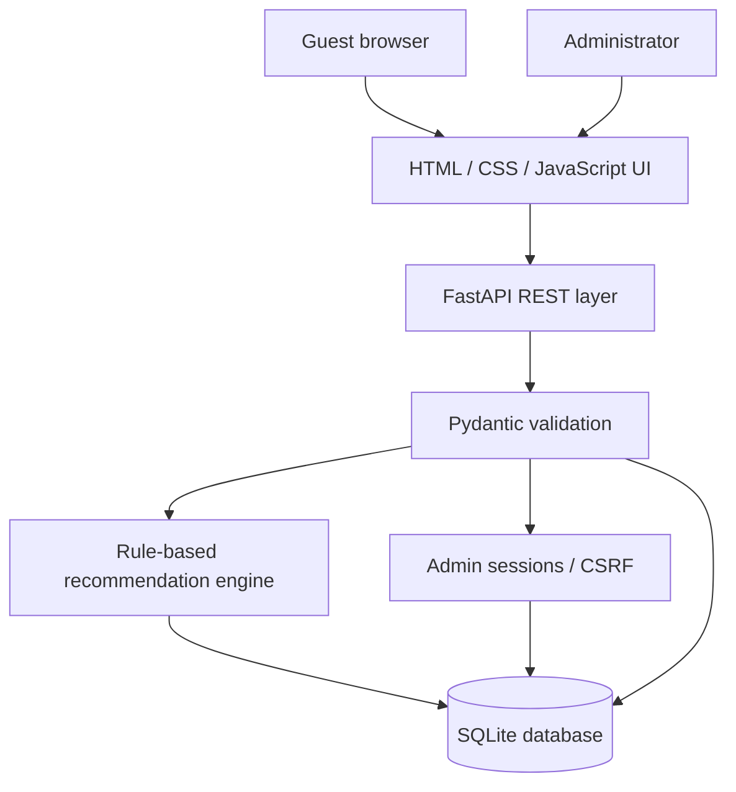
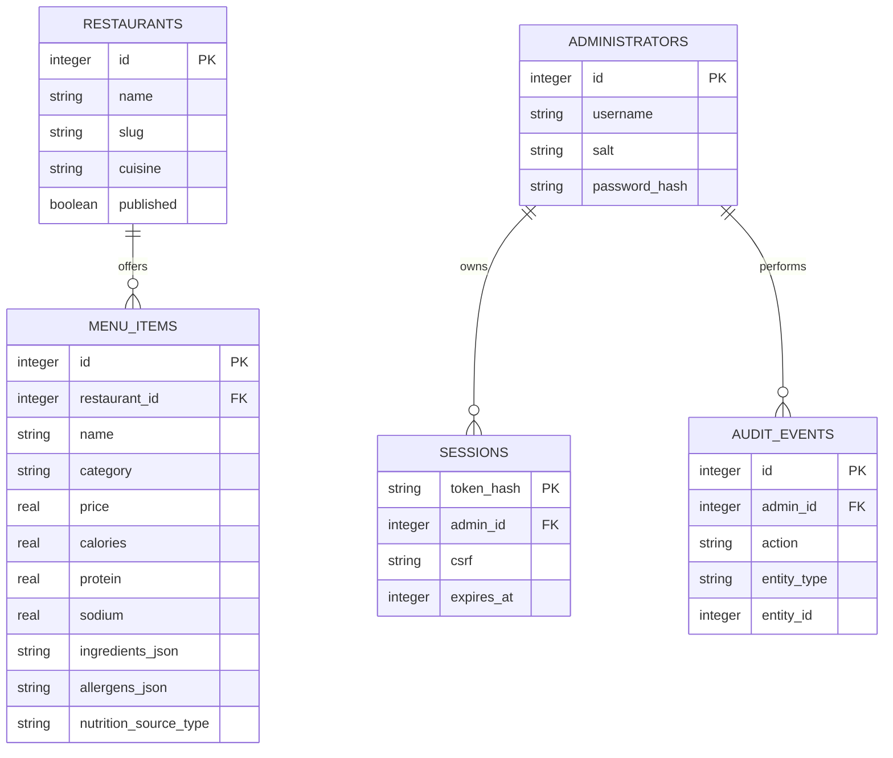
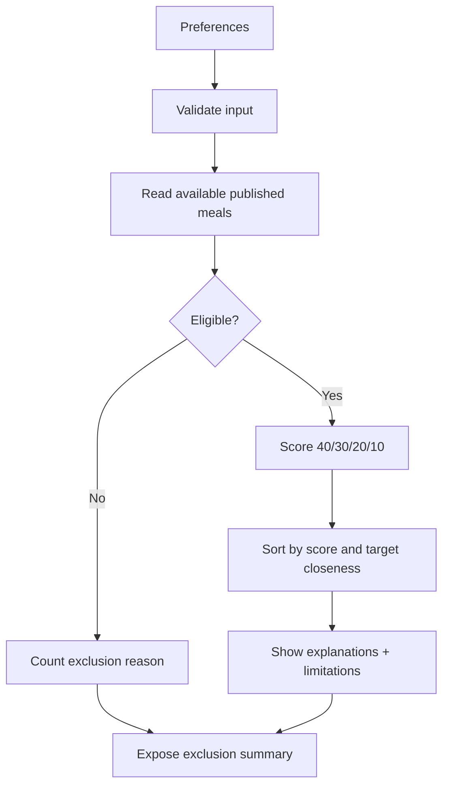

# SMARTPLATE — Technical Architecture and Design

## Architecture

The application is served from one server. It exposes public read endpoints and a separately protected `/api/admin/` namespace. Static frontend assets remain within the same origin, simplifying session-cookie and CSRF handling. SQLite is a justified, low-operations minor-project database decision.

## Data entities (actual schema)

`menu_items` stores six nullable nutrients in the chosen units (kcal, g, mg). Ingredient and allergen labels are JSON string lists; for a larger multi-restaurant application, these should be normalized into lookup and junction tables. SQLite enforces foreign keys and cascade deletion of menu items when a restaurant is removed.

## Recommendation logic

**Scoring equation:** `S = 40C + 30P + 20D + 10F`, with all factors normalized to [0, 1]. `C` denotes calorie closeness, `P` selected priority, `D` nutrient completeness, `F` fiber heuristic. The weights are arbitrary engineering parameters and **must not be presented as validated health guidance**.

## Security controls

Admin passwords use per-user random salt and `hashlib.scrypt`, not plaintext; sessions store only a SHA-256 token digest in SQLite, and the secret session token is kept in an HttpOnly SameSite=Strict cookie. Mutation requests require an additional `X-CSRF-Token` sent by same-origin JavaScript. Public filters and all database CRUD use parameterized SQL values. A basic in-memory login throttle applies 8 failed attempts per 15 minutes per address; deploying multiple replicas would require centralized rate limiting.

## Risk and limitation management

- Missing information is represented as unknown; the recommendation algorithm never substitutes zero for missing nutrients.
- Exclusions for unverified ingredient/allergen data fail closed rather than return potentially unsafe meals.
- The demo cannot rule out real-world kitchen cross-contact, label errors or nutrition variation.
- Source attribution is required in UI; starter numerical values are marked illustrative.
- Exposing SQLite write access to an internet-facing untrusted deployment should not occur without appropriate server controls, HTTPS and backups.
