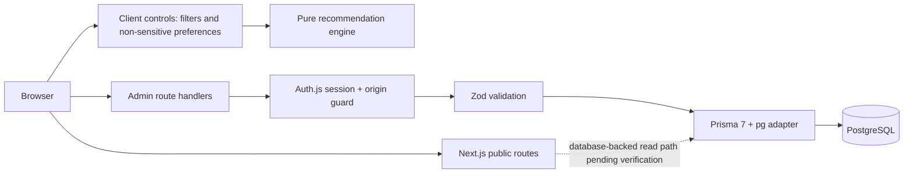
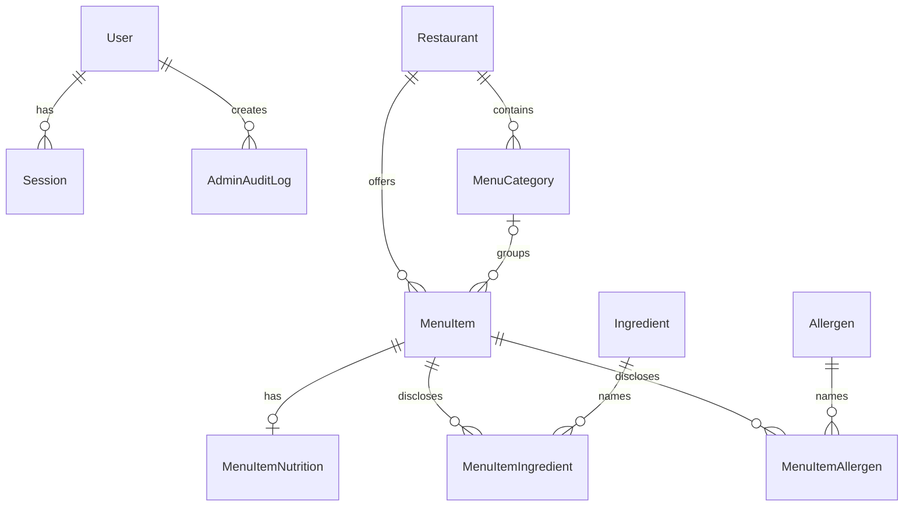
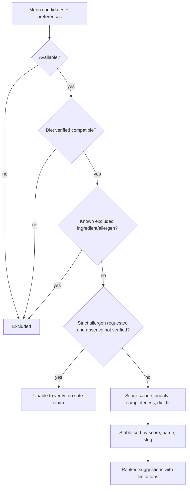
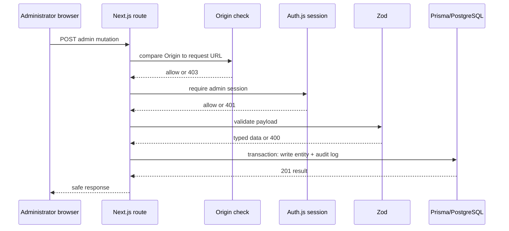

# Implementation-derived diagrams (draft)

These diagrams reflect the checked-in application as of the linked implementation ledger. They are source diagrams for the report draft, not a claim of university approval.

## Figure 1. Runtime architecture

## Figure 2. Core data model

## Figure 3. Recommendation decision flow

## Figure 4. Admin mutation sequence

